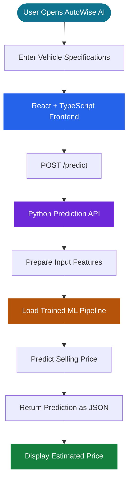

<div align="center">

# 🚘 AutoWise AI

### Intelligent Used-Car Price Prediction

**Make smarter car-buying and selling decisions with machine learning.**

A full-stack web application that estimates the resale price of a used car from its specifications using a trained regression pipeline.

<br/>

[](https://auto-wise-ai-phi.vercel.app/)
[](https://autowise-ai.onrender.com/)

<br/>


</div>

---

## 📌 Overview

**AutoWise AI** is a machine-learning-powered used-car price estimation platform. Users enter vehicle specifications and receive an estimated selling price based on patterns learned from historical used-car data.

The project combines a modern web interface, a Python prediction API, and a saved machine-learning pipeline. It also includes a Streamlit interface for interactive predictions and model evaluation.

> [!IMPORTANT]
> AutoWise AI provides an informational estimate, not a certified valuation or a guarantee of the final market price. Actual prices vary with vehicle condition, location, demand, service history, and negotiation.

## 🌐 Live Applications

| Component | Link | Purpose |
|---|---|---|
| **Frontend** | [Launch AutoWise AI](https://auto-wise-ai-phi.vercel.app/) | Interactive web application |
| **Backend API** | [Open Backend](https://autowise-ai.onrender.com/) | Receives prediction requests and returns results |

*The prediction feature depends on the backend service and its trained model being available.*

## ✨ Features

- 🚗 **Used-Car Price Prediction** — Estimates a car's selling price from its specifications.
- 🏷️ **Brand and Model Selection** — Helps users identify the vehicle being evaluated.
- 🧾 **Vehicle Specification Inputs** — Includes manufacturing year, kilometres driven, fuel, seller type, transmission, and ownership history.
- 📊 **Model Evaluation** — Supports MAE, RMSE, and R² metrics when evaluation metadata is available.
- 🧠 **Machine Learning Pipeline** — Uses a saved model pipeline to process inputs and generate estimates.
- 🔎 **Dataset Coverage** — Provides coverage information for selected brand/model combinations.
- 🖥️ **Interactive Interface** — Built with React, TypeScript, and reusable UI components.
- 📈 **Streamlit Analytics** — Provides an alternative interface for local prediction and evaluation.
- 🧰 **Training Scripts** — Supports dataset cleaning, model training, and evaluation.

## 🧭 How It Works



### Workflow Explanation

1. The user enters vehicle details in the frontend.
2. The frontend sends the details to the backend prediction endpoint.
3. The API derives the vehicle's age and prepares the input features.
4. The saved scikit-learn pipeline generates the estimated selling price.
5. The backend returns the prediction and available metadata.
6. The frontend displays the result to the user.

**Fallback behavior:** The frontend contains a simplified statistical fallback for cases where the API request fails. This fallback is not a prediction from the trained machine-learning model.

## 🧰 Technology Stack

<table>
  <tr>
    <th>Layer</th>
    <th>Technologies</th>
  </tr>
  <tr>
    <td><strong>Frontend</strong></td>
    <td>React 18, TypeScript, Vite</td>
  </tr>
  <tr>
    <td><strong>Styling</strong></td>
    <td>Tailwind CSS</td>
  </tr>
  <tr>
    <td><strong>UI and Animation</strong></td>
    <td>Framer Motion, Lucide React, Radix UI</td>
  </tr>
  <tr>
    <td><strong>Backend API</strong></td>
    <td>Python standard-library HTTP server</td>
  </tr>
  <tr>
    <td><strong>Machine Learning</strong></td>
    <td>scikit-learn, Pandas, NumPy</td>
  </tr>
  <tr>
    <td><strong>Model Serialization</strong></td>
    <td>Joblib</td>
  </tr>
  <tr>
    <td><strong>Analytics Interface</strong></td>
    <td>Streamlit</td>
  </tr>
  <tr>
    <td><strong>Frontend Deployment</strong></td>
    <td>Vercel</td>
  </tr>
  <tr>
    <td><strong>Backend Deployment</strong></td>
    <td>Render</td>
  </tr>
</table>

## 🚘 Model Features

The machine-learning pipeline uses the following input features:

| Feature | Description |
|---|---|
| `car_age` | Vehicle age derived from the manufacturing year |
| `km_driven` | Distance driven in kilometres |
| `brand` | Vehicle manufacturer |
| `car_model` | Vehicle model or variant |
| `fuel` | Fuel category |
| `seller_type` | Seller category |
| `transmission` | Manual or automatic |
| `owner` | Previous ownership category |

**Prediction target:** `selling_price`

The prediction reflects patterns learned from the training data. It should be treated as one input into a buying or selling decision, not as a definitive market valuation.

## 🗂️ Project Structure

```text
AutoWise-AI/
│
├── frontend/
│   ├── src/
│   │   ├── components/        # Predictor and reusable UI components
│   │   ├── data/              # Vehicle metadata and metrics
│   │   ├── assets/            # Images and visual assets
│   │   ├── App.tsx            # Main application and navigation
│   │   └── main.tsx           # Frontend entry point
│   ├── package.json
│   └── vite.config.ts
│
├── models/
│   ├── best_model.joblib      # Saved model pipeline and metadata
│   ├── model_comparison.csv   # Model comparison results
│   └── actual_vs_predicted.png
│
├── app.py                     # Streamlit prediction/evaluation app
├── predict_api.py             # Python HTTP prediction API
├── train_model.py             # Training and evaluation pipeline
├── clean_dataset.py           # Dataset cleaning script
├── car_utils.py               # Brand/model parsing utilities
├── used_cars.csv              # Source dataset
├── used_cars_cleaned.csv      # Cleaned dataset
├── requirements.txt           # Python dependencies
├── .env.example               # Example configuration
└── vercel.json                # Vercel configuration
```

## ⚡ Getting Started

Follow these steps to run AutoWise AI locally.

### Prerequisites

Install the following:

- Node.js and npm
- Python 3.10 or a compatible version
- pip

### 1. Clone the Repository

```bash
git clone <YOUR_REPOSITORY_URL>
cd AutoWise-AI
```

Replace `<YOUR_REPOSITORY_URL>` with your actual Git repository URL.

### 2. Create a Python Environment

```bash
python -m venv .venv
```

**Windows PowerShell**

```powershell
.\.venv\Scripts\Activate.ps1
```

**macOS / Linux**

```bash
source .venv/bin/activate
```

Install the Python dependencies:

```bash
pip install -r requirements.txt
```

### 3. Start the Backend API

Make sure the saved model exists at `models/best_model.joblib`.

Run the following command from the project root:

```bash
python predict_api.py
```

The API listens on `http://localhost:5001` by default.

### 4. Configure the Frontend

Create a `frontend/.env` file based on `frontend/.env.example`:

```env
VITE_API_URL=http://localhost:5001
VITE_STREAMLIT_URL=http://localhost:8501
```

Start the frontend in a separate terminal:

```bash
cd frontend
npm install
npm run dev
```

Open the local URL displayed by Vite in your terminal.

> Restart the frontend development server after changing environment variables.

### 5. Run the Streamlit Interface (Optional)

From the project root, activate the Python environment and run:

```bash
streamlit run app.py
```

## 🔌 API Documentation

### `GET /`

Returns API status and endpoint information.

### `GET /health`

Returns a health/status response.

### `POST /predict`

Predicts the estimated selling price of a used car.

**Example request**

```bash
curl -X POST http://localhost:5001/predict \
  -H "Content-Type: application/json" \
  -d '{
    "brand": "Maruti",
    "car_model": "Wagon R LXI Minor",
    "year": 2017,
    "km_driven": 45000,
    "fuel": "Petrol",
    "seller_type": "Individual",
    "transmission": "Manual",
    "owner": "First Owner"
  }'
```

The response includes fields such as:

- `predicted_price`
- `coverage`
- `car_age`
- `model_name`
- `reference_year`
- Processed input information

The exact response depends on the backend implementation and model metadata.

## 🧠 Train and Evaluate the Model

The training pipeline uses `used_cars_cleaned.csv` when available. Otherwise, it uses `used_cars.csv`.

### Optional: Clean the Dataset

```bash
python clean_dataset.py
```

### Train and Compare Models

```bash
python train_model.py
```

The training workflow prepares features, creates training and test splits, evaluates a Linear Regression baseline, tunes a Random Forest model using cross-validation, compares performance, and saves model artifacts under `models/`.

Expected generated artifacts include:

- `models/best_model.joblib`
- `models/model_comparison.csv`
- `models/actual_vs_predicted.png`

After retraining, ensure the deployed model and any frontend-displayed metrics are consistent with the latest artifacts.

## 🧪 Testing

The repository includes test scripts for car utilities and prediction inference:

```bash
python test_car_utils.py
python test_predictions.py
```

Run them from the project root after installing dependencies and confirming that the saved model artifact is available.

> These are test instructions, not a claim that the tests have passed. Record test results only after running the tests in the relevant environment.

## ⚙️ Configuration

The root `.env.example` documents backend configuration values:

```env
PORT=5001
HOST=0.0.0.0
MODEL_PATH=models/best_model.joblib
CORS_ORIGIN=*
```

> [!CAUTION]
> Review CORS settings before production use. The current API implementation uses permissive CORS response headers. Restrict allowed origins to trusted clients where appropriate. Never commit private `.env` files, API keys, passwords, credentials, or tokens.

## ⚠️ Limitations

- Prediction quality depends on the coverage, freshness, and quality of the training dataset.
- Rare vehicle models or combinations with limited historical examples may produce less reliable estimates.
- Vehicle condition, accident history, location, service records, and current local demand are not all represented by the listed model inputs.
- The frontend fallback is a simplified statistical calculation, not the trained ML pipeline.
- Used-car markets change over time, so periodic evaluation and retraining may be required.

## 🔭 Future Improvements

- Integrate more recent and geographically diverse used-car listings.
- Incorporate reliable vehicle-condition and service-history signals.
- Add validated prediction intervals or confidence indicators.
- Improve API validation, error responses, logging, and monitoring.
- Automate model evaluation and track model versions.
- Expand automated frontend and API test coverage.
- Improve accessibility and the overall user experience.

## 🤝 Contributing

Contributions and suggestions are welcome.

1. Fork the repository.
2. Create a focused feature branch.
3. Make and document your changes.
4. Run the relevant tests.
5. Submit a pull request with a clear summary and verification details.

## 📄 License

No license is currently specified in this repository. Add a `LICENSE` file before distributing the project under a particular open-source license.

---

<div align="center">

### 🚘 AutoWise AI

**Built with ❤️ using React, Python, and Machine Learning**

[🌐 Launch AutoWise AI](https://auto-wise-ai-phi.vercel.app/) · [⚙️ Backend API](https://autowise-ai.onrender.com/)

</div>
