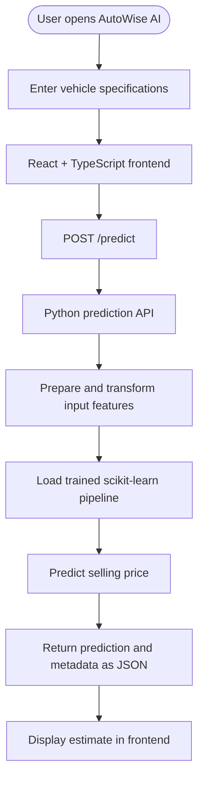

🚘 AutoWise AI
Intelligent Used-Car Price Prediction
Make smarter car-buying and selling decisions with machine learning.
A full-stack web application that estimates the resale price of a used car from its specifications using a trained regression pipeline.

📌 Overview
AutoWise AI is a machine-learning-powered used-car price estimation platform. Users enter vehicle specifications and receive an estimated selling price based on patterns learned from historical used-car data.
The project brings together a modern web interface, a Python prediction API, and a saved machine-learning pipeline. It also includes a Streamlit interface for interactive predictions and model evaluation.
[!IMPORTANT]
AutoWise AI provides an informational estimate—not a certified valuation or a guarantee of the final market price. Actual prices vary with vehicle condition, location, demand, service history, and negotiation.

🌐 Live Applications
Component	Link	Purpose
Frontend	auto-wise-ai-phi.vercel.app	Interactive web application
Backend API	autowise-ai.onrender.com	Receives prediction requests and returns results

The frontend's prediction feature depends on the backend service and its model artifact being available.
✨ Features
- 🚗 Used-car price prediction based on vehicle specifications.
- 🏷️ Brand and model selection to define the vehicle being evaluated.
- 🧾 Multiple vehicle inputs, including manufacturing year, kilometres driven, fuel, seller type, transmission, and ownership history.
- 📊 Model evaluation support with MAE, RMSE, and R² metrics when evaluation metadata is available.
- 🧠 Saved ML pipeline for preprocessing inputs and generating estimates.
- 🔎 Dataset coverage information for selected brand/model combinations.
- 🖥️ Responsive frontend built with reusable React components.
- 📈 Streamlit analytics interface for local predictions and evaluation.
- 🧰 Training and cleaning scripts to reproduce the model workflow.
🧭 How It Works

1. The user enters the car's details in the frontend.
2. The frontend sends those details to the backend prediction endpoint.
3. The API derives vehicle age and prepares the input features.
4. The saved scikit-learn pipeline generates the estimated selling price.
5. The backend returns the prediction and available metadata.
6. The frontend displays the result.
Fallback behavior: The current frontend includes a simplified statistical fallback if the API request fails. This fallback is not a prediction from the trained ML model.
🧰 Technology Stack
<table>
  <tr>
    <td width="160"><strong>Frontend</strong></td>
    <td>React 18 · TypeScript · Vite · Tailwind CSS · Framer Motion · Lucide React · Radix UI</td>
  </tr>
  <tr>
    <td><strong>Machine Learning</strong></td>
    <td>Python · Pandas · NumPy · scikit-learn · Joblib</td>
  </tr>
  <tr>
    <td><strong>Backend API</strong></td>
    <td>Python standard-library HTTP server · JSON over HTTP</td>
  </tr>
  <tr>
    <td><strong>Analytics UI</strong></td>
    <td>Streamlit</td>
  </tr>
  <tr>
    <td><strong>Deployment</strong></td>
    <td>Vercel (frontend) · Render (backend)</td>
  </tr>
</table>

🚘 Model Features
The model pipeline uses the following input features:
Feature	Description
car_age	Vehicle age derived from manufacturing year
km_driven	Distance driven, in kilometres
brand	Vehicle manufacturer
car_model	Vehicle model or variant
fuel	Fuel category
seller_type	Seller category
transmission	Manual or automatic
owner	Previous ownership category

Prediction target: selling_price
The estimate reflects the patterns in the training data. It should be treated as one input into a buying or selling decision, not as a definitive market valuation.
🗂️ Project Structure
AutoWise-AI/
├── frontend/
│   ├── src/
│   │   ├── components/       # Predictor and reusable UI components
│   │   ├── data/             # Vehicle metadata and metrics
│   │   ├── assets/           # Images and visual assets
│   │   ├── App.tsx           # Main app and view navigation
│   │   └── main.tsx          # Frontend entry point
│   ├── package.json
│   └── vite.config.ts
├── models/
│   ├── best_model.joblib     # Saved model pipeline and metadata
│   ├── model_comparison.csv  # Model comparison results
│   └── actual_vs_predicted.png
├── app.py                    # Streamlit prediction/evaluation app
├── predict_api.py            # Python HTTP prediction API
├── train_model.py            # Training and evaluation pipeline
├── clean_dataset.py          # Dataset cleaning script
├── car_utils.py              # Brand/model parsing utilities
├── used_cars.csv             # Source dataset
├── used_cars_cleaned.csv     # Cleaned dataset
├── requirements.txt          # Python dependencies
├── .env.example              # Example configuration
└── vercel.json               # Vercel configuration
⚡ Run Locally
Prerequisites
- Node.js and npm
- Python 3.10 or a compatible version
- pip
1. Clone the repository
git clone <YOUR_REPOSITORY_URL>
cd AutoWise-AI
Replace <YOUR_REPOSITORY_URL> with your repository's actual Git URL.
2. Create a Python environment
python -m venv .venv
Windows PowerShell
.\.venv\Scripts\Activate.ps1
macOS / Linux
source .venv/bin/activate
Install the dependencies:
pip install -r requirements.txt
3. Start the backend API
Confirm that models/best_model.joblib exists, then run this command from the repository root:
python predict_api.py
The API listens on http://localhost:5001 by default.
4. Configure and start the frontend
Create frontend/.env based on frontend/.env.example:
VITE_API_URL=http://localhost:5001
VITE_STREAMLIT_URL=http://localhost:8501
Then run:
cd frontend
npm install
npm run dev
Use the local URL printed by Vite. Restart the dev server whenever you change frontend environment variables.
5. Run the Streamlit interface (optional)
From the repository root:
streamlit run app.py
🔌 API Reference
GET /
Returns API status and endpoint information.
GET /health
Returns a health/status response.
POST /predict
Predicts a used car's estimated selling price.
Example request
curl -X POST http://localhost:5001/predict \
  -H "Content-Type: application/json" \
  -d '{
    "brand": "Maruti",
    "car_model": "Wagon R LXI Minor",
    "year": 2017,
    "km_driven": 45000,
    "fuel": "Petrol",
    "seller_type": "Individual",
    "transmission": "Manual",
    "owner": "First Owner"
  }'
The response includes fields such as predicted_price, coverage, car_age, model_name, reference_year, and the processed input record.
🧪 Train and Evaluate the Model
The training pipeline uses used_cars_cleaned.csv when available; otherwise, it uses used_cars.csv.
Optionally clean the dataset:
python clean_dataset.py
Train and compare models:
python train_model.py
The training workflow prepares features, creates train/test splits, evaluates a Linear Regression baseline, tunes a Random Forest model with cross-validation, compares performance, and saves model artifacts under models/.
Expected generated artifacts include:
- models/best_model.joblib
- models/model_comparison.csv
- models/actual_vs_predicted.png
After retraining, ensure the deployed model and any frontend-displayed metrics are consistent with the latest artifacts.
✅ Tests
The repository includes test scripts for car utilities and prediction inference:
python test_car_utils.py
python test_predictions.py
Run them from the repository root after installing dependencies and confirming the saved model artifact is available. These commands describe the available verification workflow; test results should only be reported after the tests have actually been run.
⚙️ Configuration
The root .env.example documents backend configuration values:
PORT=5001
HOST=0.0.0.0
MODEL_PATH=models/best_model.joblib
CORS_ORIGIN=*
[!CAUTION]
Review CORS settings before production use. The current API implementation uses permissive CORS response headers, so restrict allowed origins to trusted clients where appropriate. Never commit private .env files, API keys, credentials, or tokens.

⚠️ Limitations
- Prediction quality depends on the coverage, freshness, and quality of the training data.
- Rare models or combinations with few historical examples may produce less reliable estimates.
- Vehicle condition, accident history, location, service records, and current local demand are not all represented by the listed input features.
- The frontend fallback is a simplified statistical calculation, not the trained ML pipeline.
- Used-car markets change over time; periodic evaluation and retraining may be required.
🔭 Future Improvements
- Add more recent and geographically diverse vehicle listings.
- Incorporate reliable vehicle-condition and service-history signals.
- Add validated prediction intervals or confidence indicators.
- Improve API input validation, error responses, logging, and monitoring.
- Automate model evaluation and track model versions.
- Expand automated frontend and API test coverage.
🤝 Contributing
Contributions and suggestions are welcome.
1. Fork the repository.
2. Create a focused feature branch.
3. Make and document your changes.
4. Run the relevant tests.
5. Submit a pull request with a clear summary and verification details.
📄 License
No license is currently specified. Add a LICENSE file before distributing the project under a particular open-source license.

Built with ❤️ using React, Python, and Machine Learning
Launch AutoWise AI · Backend API

